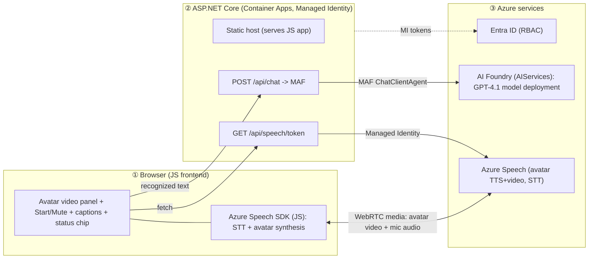
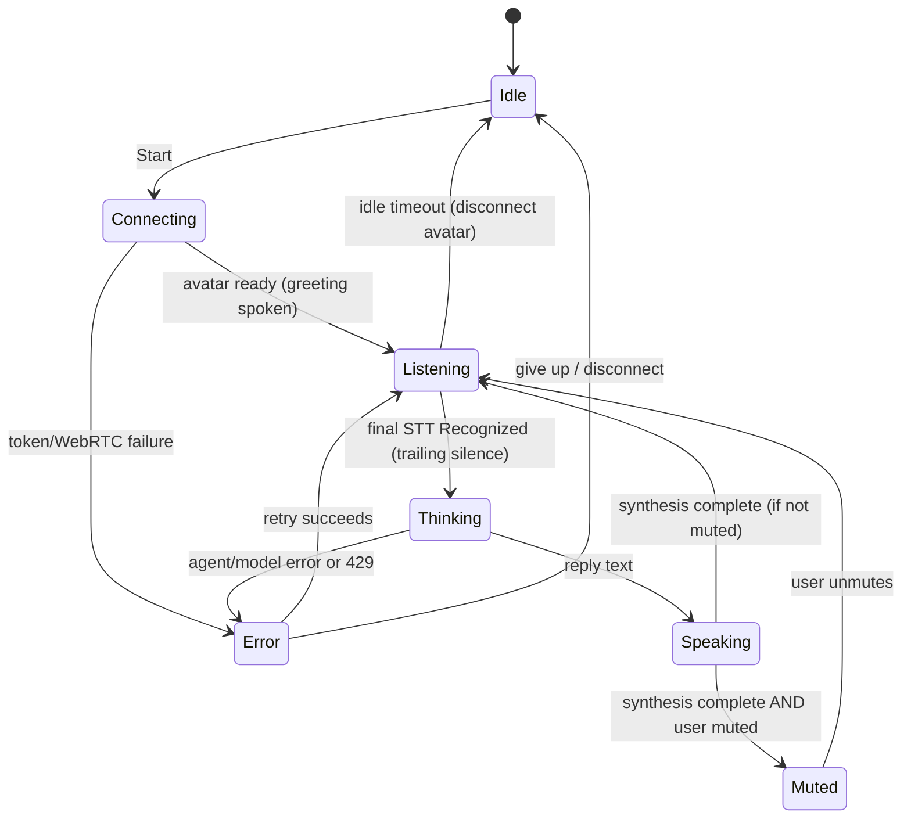

# Azure Speech Avatar — Persona Agent Web App — Design

- **Date:** 2026-07-18
- **Status:** Approved (brainstorming complete; ready for implementation planning)
- **Owner:** @JoranBergfeld

## 1. Overview

A responsive website that shows an **Azure Speech real-time avatar** and lets a
user hold a **hands-free spoken conversation** with it. The user speaks; the
avatar answers with synthesized voice and video. The avatar's behavior is
**grounded in a persona** (who it is, what it knows, how it answers) supplied as
a document with a few Q&A samples. The app uses Azure technology throughout and
leverages the **Microsoft Agent Framework (MAF)** in .NET.

This is a focused **sample/demo**, not a multi-tenant product. It should be easy
to run and deploy with a single command.

## 2. Goals and non-goals

### Goals (v1)
- Responsive single-page site displaying one avatar.
- Hands-free **voice input** (Azure Speech-to-Text) and **avatar voice + video output** (Azure real-time avatar synthesis).
- **Start conversation** button and a sticky **mute button** that pauses the microphone (for noisy environments).
- **Live captions** (recognized user text + avatar reply text) and a short spoken greeting on connect.
- **Half-duplex** turn-taking with an idle timeout that releases the avatar.
- Answers **grounded in a persona** via agent instructions + few-shot Q&A.
- **Explicit-but-graceful** error handling with an always-visible status indicator.
- **Keyless** auth (Entra + Managed Identity) and one-command `azd up` deployment.

### Non-goals (explicitly out; may be added later)
- Voice barge-in / full-duplex interruption.
- File Search / large knowledge base retrieval (RAG over many documents).
- Multiple personas or a persona-switching UI.
- End-user authentication / accounts.
- Conversation persistence and analytics.
- Native mobile apps; multiple simultaneous avatars.

## 3. Key decisions and rationale

| # | Decision | Choice | Why |
|---|----------|--------|-----|
| 1 | App shape | **ASP.NET Core Web API + lightweight JS frontend** | The real-time avatar (WebRTC) and Speech-to-Text run in the browser via the **JavaScript Speech SDK** — there is no .NET-native avatar rendering. A JS-native frontend follows the SDK's grain; the .NET backend stays a clean token + chat API. Performance is a wash vs. Blazor because the heavy media path is identical. |
| 2 | Grounding | **Persona in the agent's instructions (system prompt) + few-shot Q&A. No File Search / vector store.** | The supplied content is persona/behavioral guidance, not a fact corpus. Persona rules must apply on **every** turn; File Search only retrieves *sometimes* (query-dependent), which would make the persona inconsistent. It is small enough to live in the prompt. Dropping the managed vector store also **avoids the ALZ/MCAP guardrail risk**. |
| 3 | Agent host | **MAF `ChatClientAgent`** (`Microsoft.Agents.AI`) over an **Azure AI Foundry (AIServices) GPT-4.1 model**, with conversation held in an **in-process MAF thread per session** | Leverages MAF with the Foundry-hosted model, but keeps memory in-process. This deliberately avoids the Foundry **Agent Service** persistent-thread path, which requires a capability host (Cosmos DB + Storage + AI Search) — extra infra and more guardrail exposure. In-process memory is fine for a demo (resets on restart). |
| 4 | Model | **GPT-4.1** | Voice needs low latency + faithful instruction-following, not deep reasoning. Avoid reasoning models (gpt-5.x / o-series): they add seconds of hidden "thinking" and have the known empty-reply gotcha. Cost is not a constraint. Confirm gpt-4.1 availability in the target region (swedencentral). |
| 5 | Turn-taking | **Half-duplex, no voice barge-in** | Robust in noisy rooms: mic auto-pauses while the avatar thinks/speaks, so noise/echo cannot self-trigger STT. |
| 6 | Auth | **Keyless — Entra ID + Managed Identity** | No Key Vault / secrets to trip the private-KV policy. Browser never sees a key. |
| 7 | Hosting | **Azure Container Apps**, provisioned/deployed with **azd** (Bicep) | Single container serving JS + API, Managed Identity assigned, scale-to-zero. App Service is an equally valid swap. |

## 4. Architecture



**Key data paths**
- **Media (heavy):** Browser ⇄ Azure Speech directly over WebRTC. Avatar video and mic audio **never** pass through the backend.
- **Token:** Browser → `GET /api/speech/token` → backend uses Managed Identity to obtain a short-lived Entra token the Speech SDK consumes via `fromAuthorizationToken` (no key in the browser).
- **Chat:** Browser sends recognized text → `POST /api/chat` → MAF runs the Foundry agent on the session's thread → grounded reply text returns → browser has the avatar speak it.

## 5. Component design

### 5.1 Frontend (browser, JS)
- **Responsibilities:** render the avatar video, capture the mic, run continuous STT, drive avatar synthesis of replies, render captions and a status chip, and expose Start + Mute controls.
- **Speech SDK usage:** obtain the auth token from the backend; establish the avatar WebRTC connection; run continuous recognition; call the avatar to speak reply text.
- **Turn-taking core:** implemented as an explicit **state machine** kept separate from Speech SDK calls so it is unit-testable without a browser (see 5.3).
- **UI:** responsive layout — avatar centered, controls and captions adapting to viewport. Status chip shows healthy / degraded / disconnected.

### 5.2 Backend (ASP.NET Core)
- **Serves** the static JS app.
- **`GET /api/speech/token`** — returns a short-lived Speech authorization token (obtained via Managed Identity) plus the region. No key leaves the server.
- **`POST /api/chat`** — body: recognized text + session/thread id. Runs the MAF agent against the Foundry-hosted agent's thread and returns the reply text (and citations if any, though citations are unused in the persona-only v1).
- **MAF integration:** the backend uses the Microsoft Agent Framework (`Microsoft.Agents.AI`) **`ChatClientAgent`** over the Foundry-hosted **GPT-4.1** model. A **MAF `AgentThread` per browser session, held in an in-memory cache**, provides multi-turn memory. This is intentionally **in-process** — no server-side thread storage, so **no capability host (Cosmos/Storage/AI Search) is required**.
- **Note:** exact MAF / Foundry SDK package and API names are verified against official docs during implementation. No fabricated endpoints; any unconfirmable call becomes a documented manual step.

### 5.3 Conversation flow (state machine)



- **End of user turn:** Azure STT fires a final `Recognized` event after a configurable **trailing-silence window** (segmentation silence timeout, start ~0.8–1.2s; semantic segmentation is an option). Genuine no-speech / no-match is ignored (stay Listening).
- **Avatar stops speaking:** naturally at the end of the reply text (synthesis-completed event); a force-stop is available for errors / Stop.
- **Mute (mic) semantics:**
  - **Auto-pause:** mic is off during **Thinking** and **Speaking** so the avatar's own audio and room noise cannot self-trigger STT.
  - **Manual mute (the button):** pauses the mic at any time and is **sticky** — it takes precedence over auto-resume. If muted when the avatar finishes, the mic stays off until the user unmutes. Ideal for noisy rooms (unmute only to speak).

### 5.4 Grounding (persona)
- A repo file **`persona/persona.md`** holds the persona description, behavioral rules, and few-shot Q&A samples.
- The backend **loads this file at startup and uses it as the agent's instructions** (system prompt) — there is no separate server-side agent resource to provision. The persona instructs **short, conversational, spoken-friendly** answers and to **say "I don't know" when the persona/Q&A does not cover a question** (no hallucinating).
- **No vector store / File Search** in v1. If a factual knowledge base appears later, File Search can be added without changing the frontend or API.

### 5.5 Auth and identity
- **Managed Identity** in Azure; `az login` (DefaultAzureCredential) locally.
- **Roles required:**
  - `Cognitive Services Speech User` on the Speech resource — mint Speech tokens (works even with `disableLocalAuth=true`).
  - `Cognitive Services OpenAI User` / `Azure AI Developer` (as appropriate) on the Foundry / Azure OpenAI resource — run the agent + model.
- **Speech token flow:** backend acquires an Entra token (scope `https://cognitiveservices.azure.com/.default`) and returns it with the region; the browser Speech SDK uses `fromAuthorizationToken`. Token lifetime ~10 min; the browser refreshes via the endpoint before expiry.

### 5.6 Configuration
Settings via environment variables / App Configuration (no secrets needed):
Speech region & resource; Foundry project endpoint + agent id; model deployment (gpt-4.1); persona file path; avatar character + voice; STT/TTS language (default `en-US`); end-of-turn silence timeout (~0.8–1.2s); idle timeout.

### 5.7 Error handling — explicit but graceful
Guiding principle: **fail loudly and clearly, recover gracefully. Never disguise a system error as a conversational hiccup.**

- **Errors are named, not masked** — the app states *what* failed and offers a recovery path.
- **System failures ≠ "please repeat".** Token / WebRTC / agent / model / 429 errors are stated plainly (e.g., *"I hit an error reaching my service and can't answer right now"*), shown as a visible error state, and offer **Retry**.
- **Only genuine no-speech** gets *"I didn't catch that, say it again?"* — the sole case where the user really was unclear.
- **Persistent status chip:** healthy / degraded / disconnected, always visible.
- Specific handling: token fetch → banner + retry with backoff; mic permission denied → explicit prompt; recognition dropped (service/network) → "reconnecting…"; avatar/WebRTC drop or idle timeout → reconnect (button or on next turn); 429 → backoff with a clear "busy, retrying" message.
- Errors are logged with a **correlation id**; **no raw stack traces** reach the user; the turn-taking loop never dead-ends — it returns to Listening or offers a retry.

## 6. Testing strategy
Targeted, not exhaustive (this is a sample):
- **Backend unit tests:** `/api/speech/token` (mock credential) and `/api/chat` (mock agent client) — success shapes and error paths.
- **Turn-taking state machine:** factored out of the Speech SDK and unit-tested directly, **including each explicit error transition**.
- **Persona eval:** run the few-shot Q&A samples against the agent and assert it stays in persona and says "I don't know" when appropriate.
- **Smoke script:** verifies the token endpoint returns a token and `/api/chat` returns a grounded reply.

## 7. Deployment
- **`azd`** provisions and deploys via **Bicep** in `infra/`: the **Azure AI Foundry (AIServices) account** + **gpt-4.1** model deployment, the **Container App** + environment (with system-assigned Managed Identity), **Log Analytics**, and the **role assignments** (Speech + model). No Cosmos/Storage/AI Search, no capability host.
- The **persona** ships in the container and is loaded at startup as the agent's instructions — **no post-provision agent-creation step** is required.
- **One command:** `azd up`.

## 8. Project layout (single repo)
```
src/Api/            ASP.NET Core (controllers + Program.cs)
src/Api/wwwroot/    JS frontend (index.html, app.js, styles) + Speech SDK glue
persona/persona.md  persona description + behavioral rules + few-shot Q&A
infra/              Bicep modules
tests/              backend + state-machine unit tests
azure.yaml          azd config
README.md
```

## 9. Risks and open items
- **MAF API surface is new.** Target packages are `Microsoft.Agents.AI` + the Azure OpenAI chat client; exact `ChatClientAgent` / `AgentThread` / `RunAsync` signatures are confirmed against the installed package version at implementation time (the plan carries the current verified form). No fabricated APIs.
- **Model availability:** confirm **gpt-4.1** is deployable in the target region (swedencentral); otherwise pick the closest fast, non-reasoning instruction-following model.
- **Guardrail contingency:** the keyless design uses **no Key Vault, no vector store, and no capability-host stores** (Cosmos/Storage/AI Search), so it should satisfy ALZ/MCAP policies. The only Azure data-plane dependencies are the Speech and Foundry model endpoints reached with Managed Identity.

## 10. Future enhancements
Voice barge-in (with echo cancellation); File Search for a real knowledge base; multiple personas + switching UI; end-user auth; conversation persistence/analytics; multi-language UI.
